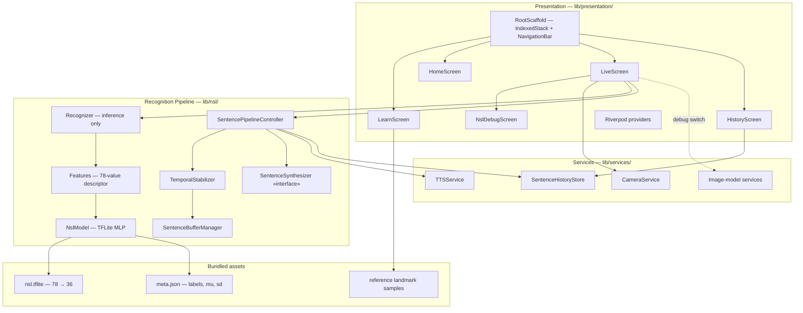
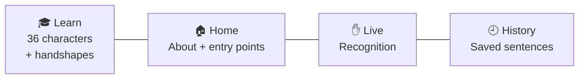
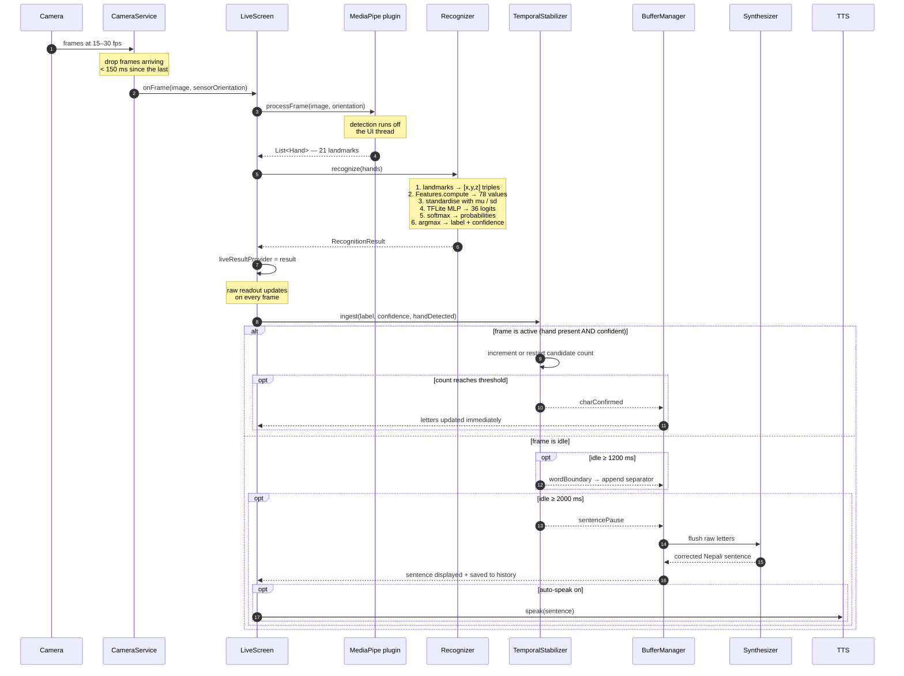
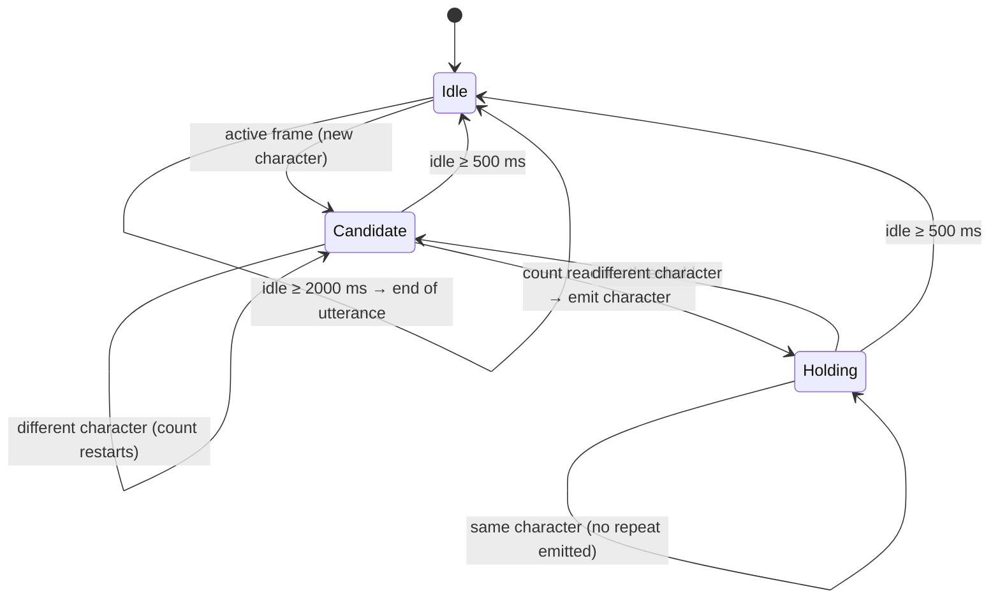
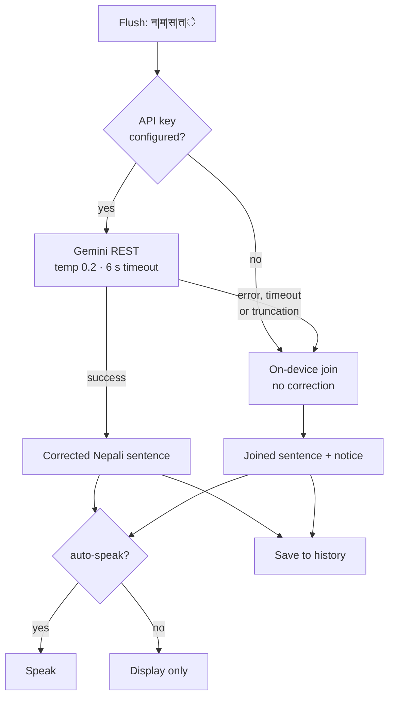
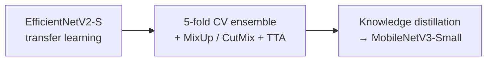

# Nepali Sign Language Recognition — Project Report

**Application:** `nsl_fyp` — *Nepali Sign Language Recognition*
**Platform:** Flutter, Android
**Category:** Final Year Project, B.Sc. CSIT

---

## Table of Contents

1. [Executive Summary](#1-executive-summary)
2. [Introduction](#2-introduction)
3. [Objectives and Scope](#3-objectives-and-scope)
4. [Requirements](#4-requirements)
5. [Technology Stack](#5-technology-stack)
6. [System Architecture](#6-system-architecture)
7. [Application Structure](#7-application-structure)
8. [Recognition Workflow](#8-recognition-workflow)
9. [Feature Engineering](#9-feature-engineering)
10. [Temporal Stabilisation and Sentence Assembly](#10-temporal-stabilisation-and-sentence-assembly)
11. [Sentence Synthesis and Speech](#11-sentence-synthesis-and-speech)
12. [Secondary Image-Based Model](#12-secondary-image-based-model)
13. [Model Development and Dataset](#13-model-development-and-dataset)
14. [Implementation Details](#14-implementation-details)
15. [Testing](#15-testing)
16. [Results and Current Status](#16-results-and-current-status)
17. [Known Limitations](#17-known-limitations)
18. [Future Work](#18-future-work)
19. [Appendices](#19-appendices)

---

## 1. Executive Summary

This project delivers an Android application that reads **Nepali Sign Language (NSL) fingerspelling** through the phone camera and converts it into **spoken Nepali**. It closes the loop from a hand gesture to audible speech entirely on a consumer device, with only an optional network call used to polish the final sentence.

The system is not a single classifier behind a camera preview. It is a **six-stage real-time pipeline**, and most of the engineering value lies in the stages either side of the classifier:

| Stage | Purpose |
|---|---|
| 1. Frame acquisition | Sample the live camera at a bounded, predictable rate |
| 2. Hand landmark detection | MediaPipe returns 21 3-D hand landmarks |
| 3. Feature engineering | Convert landmarks into a 78-value geometric descriptor |
| 4. Classification | A compact MLP maps the descriptor to one of 36 characters |
| 5. Temporal stabilisation | Collapse a noisy per-frame stream into confirmed letters, words and utterances |
| 6. Sentence synthesis and speech | Turn the letter stream into fluent Nepali and speak it |

A raw classifier alone is unusable in practice: it emits a prediction for every frame, including frames captured while the hand is moving between signs, and frames containing no hand at all. Stage 5 is what turns that stream into readable text, and stage 6 is what makes it a communication aid rather than a character-recognition demo.

The application ships **four screens** — Learn, Home, Live and History — and retains a **second, independent classifier** (image-based) that can be swapped in at runtime for comparison.

---

## 2. Introduction

### 2.1 Background

Nepali Sign Language is the primary language of the Deaf community in Nepal. As with most sign languages, few hearing people are fluent, which creates a persistent communication barrier in everyday settings — clinics, government offices, shops, classrooms — where a human interpreter is rarely available.

**Fingerspelling** is the component of NSL in which individual Devanagari characters are represented by distinct hand shapes. It is used for proper nouns, technical vocabulary, and as a fallback when a lexical sign is unknown. Because fingerspelled characters are *static* rather than *dynamic*, they are tractable for single-frame recognition — which makes fingerspelling the natural entry point for an automated NSL system.

### 2.2 Problem Statement

A working recognition product must solve four problems that a classifier by itself does not address:

1. **Robustness to appearance.** Skin tone, lighting, sleeve colour and background vary enormously. A model trained on pixels inherits all of that variation.
2. **Temporal noise.** At several frames per second, a classifier produces many predictions per signed character, including meaningless ones during hand transitions. Shown directly, this is unreadable flicker.
3. **Segmentation.** A letter stream is not a sentence. The system must infer where words end and when an utterance is complete, without the user pressing a button per character.
4. **Error tolerance.** Visually similar hand shapes will be confused. A usable system must still recover a plausible sentence despite occasional wrong characters.

### 2.3 Approach

Each problem is addressed by a dedicated architectural stage:

| Problem | Solution |
|---|---|
| Appearance robustness | Classify **geometry, not pixels** — MediaPipe landmarks reduce the hand to 21 points, discarding skin tone, lighting and background entirely |
| Temporal noise | A finite state machine confirms a character only after several consecutive agreeing, confident frames |
| Segmentation | Pause duration is interpreted: short gap resets, medium gap is a word boundary, long gap ends the utterance |
| Error tolerance | A language model rewrites the raw letter stream into grammatical Nepali, with an on-device fallback when unavailable |

Choosing landmarks over pixels is the central design decision of the project. It makes the classifier small (about 200 KB), fast, and independent of how the user looks or where they are standing.

---

## 3. Objectives and Scope

### 3.1 Objectives

1. Recognise the **36 Devanagari consonant characters** of the NSL fingerspelling alphabet from a live camera feed.
2. Perform recognition **entirely on-device**, with no network dependency in the recognition path.
3. Assemble recognised characters into a **coherent Nepali sentence**.
4. **Speak** the resulting sentence in Nepali.
5. Provide **real-time feedback** so the user can see whether their hand is detected and how close a character is to being committed.
6. Provide a **reference screen** showing every character the system knows.
7. Keep a **durable record** of everything the app has said.

### 3.2 In Scope

- Static, single-hand fingerspelling of 36 Devanagari consonants
- Real-time single-user operation on a mid-range Android phone
- Nepali-language sentence output and speech

### 3.3 Out of Scope

- **Dynamic gestures** requiring motion over time — recognition is single-frame
- **Two-handed signs** — the detector is configured for one hand
- **Vowels, numerals and lexical (word-level) signs**
- **Sign generation** (text → signing avatar); the system is unidirectional
- **iOS** — the hand landmark plugin is Android-only

---

## 4. Requirements

### 4.1 Functional Requirements

| ID | Requirement | Status |
|---|---|---|
| FR-01 | Display a live camera preview | Implemented |
| FR-02 | Sample frames at a bounded rate | Implemented |
| FR-03 | Detect hand landmarks in each sampled frame | Implemented |
| FR-04 | Classify the hand into one of 36 characters | Implemented |
| FR-05 | Display the raw per-frame prediction and confidence continuously | Implemented |
| FR-06 | Confirm a character only after it is held steadily | Implemented |
| FR-07 | Show progress toward confirmation | Implemented |
| FR-08 | Infer word boundaries from pauses | Implemented |
| FR-09 | Detect end of utterance and synthesise a sentence | Implemented |
| FR-10 | Correct the raw letter stream into fluent Nepali | Implemented |
| FR-11 | Speak the synthesised sentence | Implemented |
| FR-12 | Mute / unmute automatic speech | Implemented |
| FR-13 | Delete the last confirmed character | Implemented |
| FR-14 | Force synthesis without waiting for a pause | Implemented |
| FR-15 | Clear letters, sentence and context | Implemented |
| FR-16 | Switch between front and rear camera | Implemented |
| FR-17 | Browse all recognisable characters with example handshapes | Implemented |
| FR-18 | Persist and review past sentences | Implemented |
| FR-19 | Switch classifier at runtime for comparison | Implemented (debug screen) |
| FR-20 | Tune recognition thresholds on-device | Implemented (debug screen) |

### 4.2 Non-Functional Requirements

| ID | Requirement | How it is met |
|---|---|---|
| NFR-01 | UI must stay responsive during inference | Landmark detection runs off-thread in the plugin; the classifier is small enough to run inline |
| NFR-02 | Per-character hold time ≈ 450 ms | 3 confirming frames × 150 ms sample interval |
| NFR-03 | Camera hardware never opened twice concurrently | Async-mutex serialisation in `CameraService` |
| NFR-04 | Slow devices must not queue frames | Rate limiting plus an in-flight guard |
| NFR-05 | Recognition works with no network | Model and metadata are bundled assets |
| NFR-06 | Model parameters never hardcoded | Labels, `mu`, `sd` read from `meta.json` at runtime |
| NFR-07 | A mismatched model must fail loudly | Startup validation of tensor shapes, dtype and label count |
| NFR-08 | No API key in version control | Key injected at build time |
| NFR-09 | Camera frames never leave the device | Only the final letter string is transmitted |
| NFR-10 | User can distinguish "not working" from "filtering" | Raw prediction stays on screen alongside debounced letters |
| NFR-11 | UI must not depend on ML or networking libraries | Repository interface in the domain layer |

---

## 5. Technology Stack

| Layer | Technology | Rationale |
|---|---|---|
| UI framework | Flutter | Single codebase, native-speed rendering, first-class camera support |
| Language | Dart | Sound null safety; isolates give true parallelism |
| State management | `flutter_riverpod` | Compile-safe dependency injection; provider scoping controls service lifetimes |
| Navigation | `go_router` | Declarative routing, ready for deep links |
| Camera | `camera` + `camera_android` | Exposes a raw frame stream. `camera_android` pins the legacy Camera2 implementation, which streams reliably on the target device |
| Hand landmarks | `hand_landmarker` | MediaPipe HandLandmarker; returns 21 3-D landmarks with detection running off the UI thread |
| Inference | `tflite_flutter` | Direct FFI binding to the TensorFlow Lite C API |
| Image processing | `image` | Pure-Dart pixel access, usable inside an isolate |
| Text-to-speech | `flutter_tts` | Wraps the platform TTS engine; supports accurate completion callbacks |
| Networking | `http` | Minimal client for the sentence-synthesis call |
| Local storage | `shared_preferences` | Durable sentence history |
| Permissions | `permission_handler` | Runtime camera permission |
| Training | TensorFlow / Keras, scikit-learn, MediaPipe | Model development |

---

## 6. System Architecture

### 6.1 Architectural Style

A **layered / Clean Architecture** arrangement, with a repository abstraction separating presentation from infrastructure and a strategy pattern for interchangeable sentence-synthesis backends.



### 6.2 Layer Responsibilities

| Layer | Responsibility | Must not |
|---|---|---|
| **Presentation** | Render UI, own screen lifecycle, route user intent | Touch TFLite, HTTP or tensors directly |
| **Domain** | Define the recognition contract | Depend on any concrete implementation |
| **Data** | Adapt services to the domain contract; transport-neutral models | Contain business rules |
| **Pipeline (`lib/nsl/`)** | All timing, buffering, synthesis and speech logic | Depend on Flutter widgets |
| **Services** | Encapsulate camera, inference, storage, TTS | Depend on presentation |
| **Core** | Configuration, routing, theming | Contain logic |

### 6.3 Directory Structure

```
lib/
├── main.dart
├── core/
│   ├── config/app_config.dart          All tunable constants
│   ├── routing/app_router.dart
│   ├── theme/app_theme.dart
│   └── utils/constants.dart            Copy, layout, tab indices
├── domain/repositeries/
│   └── recognition_repository.dart     Abstract recognition contract
├── data/
│   ├── models/                         RecognitionResult, RecognitionBackend, …
│   └── repositories/
├── nsl/                                Recognition pipeline
│   ├── features.dart                   Landmarks → 78 features
│   ├── model.dart                      TFLite MLP + metadata
│   ├── recognizer.dart                 Per-frame inference
│   ├── temporal_stabilizer.dart        Frame stream → discrete events
│   ├── stabilized_event.dart
│   ├── buffer_manager.dart             Letter accumulation + flush triggers
│   ├── sentence_pipeline_controller.dart   Orchestrator
│   ├── sentence_synthesizer.dart       Strategy interface + on-device fallback
│   ├── gemini_rest_synthesizer.dart    LLM backend
│   └── landmark_diagnostics.dart       Camera-path diagnostics
├── services/
│   ├── camera/                         Camera lifecycle + frame conversion
│   ├── history/                        Durable sentence history
│   ├── tts/                            Devanagari-aware speech
│   └── offline_model/                  Secondary image-based classifier
└── presentation/
    ├── learn/                          Character reference
    ├── home/
    ├── live/                           Recognition + debug screens
    ├── history/
    ├── providers/
    └── widgets/
```

---

## 7. Application Structure

Four tabs behind a persistent navigation bar, held in an `IndexedStack` so screen state survives tab switches.



| Tab | Purpose |
|---|---|
| **Learn** | Grid of all 36 characters. Each tile renders a hand skeleton drawn from a real reference sample, so the user sees the actual geometry the system expects rather than an artist's impression. Tapping opens a full-size, swipeable detail view. |
| **Home** | Project description and entry points into Live and Learn. |
| **Live** | The recognition screen: camera preview, live prediction readout, hold-progress indicator, and the sentence panel with Done / Undo / Clear / Speak. Long-pressing the title opens the debug screen. |
| **History** | Every sentence the app has produced, persisted across restarts, with speak, copy and swipe-to-delete. |

A hidden **debug screen** (long-press the Live title, or tap the model chip) exposes the live diagnostic figures, runtime threshold sliders, the classifier switch, and camera-path diagnostics. It is deliberately out of the way so it never appears during normal use.

---

## 8. Recognition Workflow

This is the core of the system.

### 8.1 End-to-End Flow



### 8.2 Stage-by-Stage Transformation

| # | Stage | Input | Output |
|---|---|---|---|
| 1 | Capture | — | `CameraImage`, YUV420 |
| 2 | Rate limiting | frames at 15–30 fps | frames at ≤ 6.6 fps |
| 3 | Landmark detection | `CameraImage` | 21 landmarks, each `(x, y, z)` normalised |
| 4 | Feature extraction | 21 × 3 landmarks | 78 float values |
| 5 | Standardisation | 78 raw features | 78 standardised features |
| 6 | Inference | `[1, 78]` float32 | `[1, 36]` float32 logits |
| 7 | Softmax + argmax | 36 logits | label + confidence |
| 8 | Stabilisation | per-frame results + wall clock | discrete events |
| 9 | Buffering | events | raw letter string, e.g. `न\|म\|स\|त\|े` |
| 10 | Synthesis | letter string | fluent Nepali sentence |
| 11 | Speech + storage | sentence | audio + persisted history |

### 8.3 Why Landmarks Rather Than Pixels

| | Pixel-based | Landmark-based (chosen) |
|---|---|---|
| Sensitive to skin tone / lighting | Yes | **No** |
| Sensitive to background | Yes | **No** |
| Model size | ~2 MB | **~200 KB** |
| Input dimensionality | 96 × 96 = 9,216 | **78** |
| Preprocessing complexity | Multi-stage image chain | **One arithmetic function** |

Reducing the hand to 21 points before classification removes most of the nuisance variation at a stroke. The classifier then only has to learn geometry, which is exactly what distinguishes one fingerspelled character from another.

---

## 9. Feature Engineering

The 78-value descriptor is the interface between MediaPipe and the classifier, and its layout is fixed by the trained model.

### 9.1 Construction

```
Input: 21 landmarks, each (x, y, z)

Step 1 — Translate      Subtract the wrist (landmark 0) from every point,
                        placing the wrist at the origin.

Step 2 — Scale          Divide every point by the wrist → middle-finger-MCP
                        distance, normalising for hand size and distance
                        from the camera.

Step 3 — Assemble       [ 0 – 62 ]  63 normalised coordinates (21 × xyz)
                        [ 63 – 72 ]  10 pairwise fingertip distances
                        [ 73 – 77 ]   5 finger curl angles
                        --------------------------------------------
                                     78 values
```

### 9.2 What Each Block Contributes

| Block | Values | Captures |
|---|---|---|
| Normalised coordinates | 63 | Overall hand posture and finger positions |
| Fingertip distances | 10 | Whether fingers are spread or touching — every pair among the five tips |
| Curl angles | 5 | How bent each finger is, computed as the angle between its two bone segments |

The distances and angles are **redundant** with the coordinates in principle: a model could derive them. Providing them explicitly gives the network features that are already invariant to rotation, which makes the learning problem easier and the model smaller.

### 9.3 Invariance Properties

| Property | Invariant? | Consequence |
|---|---|---|
| Hand position in frame | **Yes** — step 1 removes it | User can sign anywhere in view |
| Hand size / camera distance | **Yes** — step 2 removes it | Works at arm's length or close up |
| Rotation | **No** — coordinates are raw | The hand should be held broadly upright |
| Handedness | **No** — a mirrored right hand is geometrically a left hand | Consistency between training and use matters |

The last two are genuine constraints and are documented in [Limitations](#17-known-limitations).

### 9.4 Standardisation

Before inference, each feature is standardised as `(value − mu) / sd`, using per-feature statistics computed during training and shipped in `meta.json`. These are **model parameters, not settings**: a mismatched pair produces a working interpreter that confidently predicts the wrong class. They are therefore read from the metadata file at runtime and never hardcoded.

---

## 10. Temporal Stabilisation and Sentence Assembly

### 10.1 The Problem

The classifier produces a prediction for **every** frame, including frames captured while the hand is moving between signs and frames with no hand at all. Writing those straight to the screen produces flicker and phantom letters.

### 10.2 State Machine

A frame counts as **active** when a hand was detected *and* confidence clears the threshold. Everything else is **idle**.



### 10.3 Properties Worth Noting

- **One event per hold.** Holding a sign steady for five seconds yields exactly one letter, not thirty.
- **Doubled letters are expressible.** The "last emitted" memory clears after a real pause, so क क can be signed by separating the two with a brief gap.
- **Single-frame tolerance.** The reset is time-based, not frame-based: one dropped detection does not destroy progress, provided the next good frame arrives within the idle gap. This matters because landmark detection intermittently misses a frame during live video.
- **Boundaries fire once per pause.** Latches prevent an idle camera from emitting an endless stream of separators.
- **Wall-clock driven.** A timer re-evaluates idle time independently of frames arriving, so a pause is still detected if the stream stalls or the user simply drops their hand after the last frame.

### 10.4 Buffering and Flush

Confirmed characters accumulate in a buffer that decides *when* to synthesise. Calling the language model once per utterance rather than once per letter is the single decision that dominates both latency and quota — and it is made entirely on-device.

**Flush triggers:**

1. An end-of-utterance pause
2. The buffer reaching its character cap
3. The user pressing **Done**, or the screen releasing the camera

**Hygiene rules:** leading and doubled separators are dropped, trailing separators stripped, and a separator-only buffer is discarded rather than sent for synthesis. On flush the display retains the just-flushed letters, so the panel the user is reading does not blank out while the sentence is being produced.

---

## 11. Sentence Synthesis and Speech

### 11.1 Backend Selection

Most-capable-first, degrading rather than failing:



### 11.2 The Prompt

The model is instructed to segment the stream into words (treating the separator as a hint, not ground truth), correct likely misrecognitions using context, produce one fluent grammatical Nepali sentence, and use only information present in the stream rather than inventing content. Worked examples are included, and recent sentences are carried as conversational context.

### 11.3 Robustness

| Safeguard | Reason |
|---|---|
| Explicit UTF-8 decoding | The default fallback mangles Devanagari |
| Truncated replies discarded | A cut-off sentence reads as a complete one and would be spoken as such |
| Response cleaning | Strips echoed prefixes, quotes, and any explanation beyond the first line |
| Generation counter | A slow response cannot overwrite a newer sentence |
| Timeout | The sentence layer is an enhancement; it must never hang the pipeline |

### 11.4 Speech

Devanagari speech is not universally available. The service probes Nepali first, then Hindi — far more commonly installed and reading the same script, so output stays intelligible even though pronunciation is not native — and reports when neither is present rather than failing silently. Each new sentence interrupts the previous one so the user never hears stale output.

---

## 12. Secondary Image-Based Model

An earlier, independent classifier is retained and can be selected at runtime from the debug screen. It takes a completely different approach:

```
Camera frame → palm detection → crop to hand → grayscale
   → histogram equalisation → adaptive threshold (silhouette)
   → crop to foreground → resize 96×96 → MobileNetV3-Small → 36 classes
```

It runs on a dedicated background isolate, because its per-pixel work is heavy enough to block the UI thread and destabilise the camera stream if run inline.

**Why it is kept:** having two independent classifiers behind one switch makes it possible to sign the same character into both, on the same camera and the same hand, and compare. That is the fastest way to tell whether a bad prediction comes from the model or from something upstream of it.

---

## 13. Model Development and Dataset

### 13.1 Dataset

| Property | Value |
|---|---|
| Source | Kaggle — *Nepali Sign Language Character Dataset* (NSLv2) |
| Subsets | Plain Background, Random Background |
| Total images | **54,000** |
| Classes | **36** Devanagari consonants |
| Images per class | 1,500 (balanced) |
| Held-out test split | 8,100 (15%), stratified by class and background |

Stratifying on the joint (class, background) key means both background conditions are proportionally represented in the test set, so per-background accuracy is meaningful rather than an artefact of the split.

### 13.2 Image-Based Lineage



| Phase | Approach | Held-out accuracy |
|---|---|---|
| Baseline | EfficientNetV2-S, two-stage fine-tuning, label smoothing, no horizontal flip (several signs are handedness-specific) | 1.0000 |
| Ensemble | 5-fold stratified CV, MixUp + CutMix, test-time augmentation, softmax averaging | 0.9998 – 1.0000 per fold |
| Distillation | Logit-based KD (T = 4.0, α = 0.4) into MobileNetV3-Small | **0.9995** |

Distillation compressed a five-model ensemble — far too large for a phone — into a single mobile network while retaining essentially all of its accuracy.

### 13.3 Landmark-Based Model (Deployed)

| Property | Value |
|---|---|
| Input | `[1, 78]` float32 — standardised features |
| Output | `[1, 36]` float32 — raw logits (softmax applied in the app) |
| Architecture | Small multi-layer perceptron |
| Size | ~200 KB |
| Reported accuracy | ~94% on a held-out test set |

The metadata file ships alongside it with the label list, per-feature `mu` and `sd`, and the detection confidence used during landmark extraction.

### 13.4 Interpreting the Accuracy Figures Honestly

The image-model figures above are measured on a held-out split of the **same dataset** — controlled photographs under two background conditions. They demonstrate that the architecture and training procedure are sound; they do **not** predict live camera accuracy, which is measured under very different conditions. This distinction is discussed in [Results](#16-results-and-current-status).

---

## 14. Implementation Details

### 14.1 Camera Sharing

Only one physical camera can be open at a time, and multiple screens historically wanted it. Two mechanisms keep this safe:

1. **Tab-gated acquisition.** A screen acquires the camera when it becomes the active tab and releases it when it stops being active — driven by navigation state, not widget mounting.
2. **Serialised lifecycle.** Open, switch and stop operations run through an async mutex, so a tab switch that triggers a release and an acquire back-to-back cannot produce two concurrent native camera opens.

### 14.2 Back-Pressure

Two independent mechanisms prevent frames piling up:

- **Rate limiting** — frames arriving sooner than the sample interval are dropped before any work
- **In-flight guard** — a new frame is dropped while the previous one is still being processed

Together these make the sample interval an *upper bound*, not a guarantee: a slow device self-limits rather than accumulating latency.

### 14.3 Threading

Landmark detection runs off the UI thread inside the plugin, and the classifier is small enough (~50k parameters) that inference is sub-millisecond and can run inline. The secondary image model, whose per-pixel work is far heavier, runs on a dedicated isolate.

### 14.4 Configuration

All tunable values live in one file, so integrating a change should not require touching screens or services.

| Parameter | Value | Meaning |
|---|---|---|
| Frame sample interval | 150 ms | Upper bound on processing rate |
| Confidence threshold | 0.80 | Minimum confidence for a frame to count |
| Stable frame count | 3 | Confirming frames per character (≈ 450 ms hold) |
| Idle gap | 500 ms | Candidate reset; also enables doubled letters |
| Word boundary | 1200 ms | Inserts a separator |
| End of utterance | 2000 ms | Flushes to the synthesiser |
| Buffer cap | 30 characters | Forces a flush without a pause |
| LLM timeout | 6 s | Beyond this, fall back to raw letters |
| History context | 5 sentences | Conversational context for the language model |

The confidence threshold and stable frame count are **adjustable at runtime** from the debug screen, because the right values can only be found by measurement on real hardware.

### 14.5 Privacy

| Property | Status |
|---|---|
| Camera frames leaving the device | **Never** |
| Data transmitted | Only the recognised letter string and recent sentences |
| Stored imagery | None |
| Analytics / accounts | None |

Because only a short text string ever crosses the network, the privacy exposure is far smaller than a design that uploads frames for server-side inference.

---

## 15. Testing

**79 automated tests**, all passing.

| Area | Coverage |
|---|---|
| Temporal stabilisation | 15 tests — confirmation timing, confidence gating, no-hand handling, boundary latching, doubled letters, single-frame tolerance, reset |
| Sentence buffering | 13 tests — accumulation, all three flush triggers, separator hygiene, undo, clear |
| Sentence synthesis | 19 tests — both backends, prompt and context handling, UTF-8 decoding, HTTP and timeout failures, truncation rejection, response cleaning |
| History persistence | 11 tests — append, deduplication, cap enforcement, removal, clearing, and graceful handling of corrupt stored data |
| Image preprocessing | Golden-file comparison of every intermediate stage against reference output |
| Application boot | Smoke test |

Two design choices make this coverage possible:

- **The stabiliser is pure and clock-injected** — time is a parameter, never read internally — so every timing behaviour is deterministically testable without real waits.
- **Network behaviour is tested against a mocked client**, so failure modes (timeout, error status, truncated reply) are exercised without a live connection.

---

## 16. Results and Current Status

### 16.1 Feature Completion

| Subsystem | Status |
|---|---|
| Application scaffold, four-tab navigation, theming | ✅ Complete |
| Camera acquisition and lifecycle arbitration | ✅ Complete |
| Hand landmark detection | ✅ Complete |
| Feature extraction | ✅ Complete |
| On-device classification | ✅ Complete |
| Temporal stabilisation | ✅ Complete |
| Buffering and flush logic | ✅ Complete |
| LLM sentence synthesis | ✅ Complete |
| On-device fallback synthesis | ✅ Complete |
| Text-to-speech | ✅ Complete |
| Learn screen with reference handshapes | ✅ Complete |
| Persistent sentence history | ✅ Complete |
| Debug and tuning screen | ✅ Complete |
| Secondary image classifier | ✅ Retained, runtime-switchable |

### 16.2 Live Performance

Under live camera conditions the system reliably **detects the hand**, produces predictions, and drives the full stabilise → buffer → synthesise → speak chain end to end. Character-level accuracy in live use is currently **below** the dataset figures reported in §13.

This gap is the main outstanding engineering item and is under active investigation. It is consistent with a mismatch between the conditions in which the training landmarks were captured and those the live camera produces — the descriptor is deliberately invariant to hand position and size, but not to orientation or handedness (§9.3), so a systematic difference in either shifts every feature at once.

To support that investigation, the debug screen exposes:

- **Detection rate** — the fraction of recent frames in which a hand was found, which separates "the detector is not seeing the hand" from "the detector sees it and the classifier is wrong". These have entirely different remedies.
- **Landmark geometry** — the shape and orientation of the live landmark cloud, compared against reference values.
- **Runtime threshold sliders** and a **classifier switch**, so behaviour can be compared without rebuilding.

Stating this plainly is deliberate: the pipeline, architecture and supporting screens are complete and working, and the remaining problem is a well-characterised calibration issue rather than a structural one.

---

## 17. Known Limitations

| # | Limitation | Detail |
|---|---|---|
| L-1 | Static characters only | Single-frame recognition; no temporal model over gestures |
| L-2 | Single hand | The detector is configured for one hand |
| L-3 | Consonants only | 36 classes; no vowels, numerals or word-level signs |
| L-4 | Live accuracy below dataset accuracy | See §16.2 |
| L-5 | Not rotation invariant | The descriptor uses raw coordinates, so the hand should be held broadly upright |
| L-6 | Not mirror invariant | A mirrored right hand is geometrically a left hand |
| L-7 | Thresholds need on-device tuning | Defaults were set against a different classifier; the debug sliders exist for this |
| L-8 | Sentence correction requires network | Falls back to a mechanical join offline |
| L-9 | Nepali voice may be absent | Falls back to Hindi pronunciation |
| L-10 | Android only | The landmark plugin has no iOS support |
| L-11 | API key recoverable from the build | Acceptable for an academic project key; a proxied backend is the intended end state |

---

## 18. Future Work

**Validation**

1. Record a labelled evaluation set through the application's own camera path and measure end-to-end accuracy under deployment conditions.
2. Complete the threshold tuning pass against measured on-device behaviour.

**Robustness**

3. Add rotation invariance to the descriptor — for example by aligning the hand to a canonical axis before extracting coordinates — removing the upright-hand constraint.
4. Normalise handedness explicitly, so either hand works regardless of camera.
5. Extend the training set with landmarks captured through a phone camera, so training and deployment conditions match.

**Capability**

6. Dynamic gesture recognition via a temporal model over per-frame descriptors.
7. Vowels, numerals and lexical signs.
8. Two-handed sign support.
9. On-device sentence correction, removing the network dependency entirely.

**Product**

10. Practice mode — present a target character and score the attempt.
11. Export or share saved sentences.
12. Accessibility review, including users with limited hand mobility.

---

## 19. Appendices

### Appendix A: Feature Vector Layout

| Index range | Count | Content |
|---|---|---|
| 0 – 62 | 63 | 21 landmarks × (x, y, z), normalised |
| 63 – 72 | 10 | Pairwise distances between the five fingertips |
| 73 – 77 | 5 | Curl angle of each finger |
| **Total** | **78** | |

### Appendix B: Bundled Assets

| File | Purpose |
|---|---|
| `nsl.tflite` | Landmark classifier — 78 → 36 |
| `meta.json` | Labels, per-feature `mu` and `sd`, detection confidence |
| `parity.json` | Reference landmark samples, one per character — used to draw the handshapes on the Learn screen |
| `nsl_single_fp16.tflite` | Secondary image classifier |
| `palm_detection.tflite` | Palm detector for the image pipeline |

### Appendix C: The 36 Characters

```
क  ख  ग  घ  ङ    च  छ  ज  झ  ञ
ट  ठ  ड  ढ  ण    त  थ  द  ध  न
प  फ  ब  भ  म    य  र  ल  व  श
ष  स  ह  क्ष  त्र  ज्ञ
```

### Appendix D: Build and Run

```bash
flutter pub get
flutter run --dart-define-from-file=env.json      # debug
flutter build apk --release --split-per-abi --dart-define-from-file=env.json
```

Requires the Android SDK and JDK 17. `env.json` holds the sentence-synthesis API key and is excluded from version control; without it the app still runs and falls back to on-device sentence assembly.

---

*End of report.*
